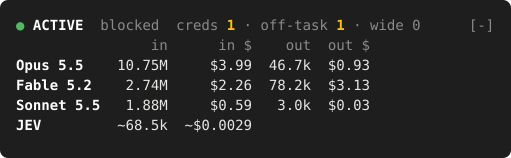

# claude-jev-mods

## 1. Introduction

This repository contains `jev`, a mod for Claude Code.

The mod uses [Jev 1.14](https://openrouter.ai/typesafe/jev-1.14) to make decisions for Claude Code. Jev is a decision model from TypeSafe. You use Jev through OpenRouter. Jev does not write text. Jev gives a probability for each question that the mod asks. Each answer takes approximately 0.1 seconds.

The mod does these tasks:

- **It selects the model for each prompt.** Planning and review go to Opus. Medium coding goes to Sonnet. Clearly defined tasks go to Haiku. The first prompt of a session always goes to Opus. If Jev is not sure, the prompt goes to Opus.
- **It selects the model for each subagent.** The mod uses the same rules as for prompts. Haiku also writes a short brief for each subagent.
- **It controls the order of subagents.** A new subagent starts only if Jev is sure that it does not depend on the subagents that run.
- **It blocks reads of credentials.** Rules block `.env` files, private keys, credential stores, environment dumps and credential helpers. The rules do not use Jev. Jev examines all other file reads, searches and shell commands.
- **It blocks reads of source code that is not related to the task.** Jev must be sure that the file is not necessary for the task. The command `/jev allow <path-or-glob>` removes this check for a path.
- **It blocks searches that are too wide.** A search that starts at `/`, at a top-level folder or above your home folder is blocked. The search continues only if Jev is sure that the task needs a system-wide search.
- **It shows a band above the prompt.** The band shows the blocks and the token use and cost of each model. Refer to section 5.

If the OpenRouter key is not set, the mod does none of these tasks. The band then shows a red warning.

> **NOTE:** The guards are not perfect. Jev examines the path or the command. Jev does not examine the contents of a file. An unusual command can possibly go past the rules and Jev.

## 2. Screenshot



This image shows the band from the session that developed this version of the mod. The mod's own band code made the image. The Claude rows show the real token use of that session. The JEV row is an estimate, and the `~` mark shows this.

## 3. Prerequisites

You must have these items:

- Claude Code 2.1.321 or a later version.
- An OpenRouter account.
- An OpenRouter API key. Get the key from [openrouter.ai/keys](https://openrouter.ai/keys).

### 3.1. Put the API key in the Claude Code settings

The mod reads the key from the `OPENROUTER_API_KEY` environment variable. Put the key in the `env` block of your user settings. Claude Code then sets the variable for its own process and for each command that it starts. This includes the commands that Claude Code runs in the sandbox.

1. Open the file `~/.claude/settings.json`. If the file does not exist, make a new file.
2. Add the `env` block below. If the file has an `env` block, add only the `OPENROUTER_API_KEY` line to it.

   ```json
   {
     "env": {
       "OPENROUTER_API_KEY": "sk-or-v1-your-key"
     }
   }
   ```

3. Replace `sk-or-v1-your-key` with your key.
4. Save the file.
5. Restart Claude Code.

> **WARNING:** Put the key only in your user settings, `~/.claude/settings.json`. Do not put the key in the settings of a project, `.claude/settings.json`. You can accidentally commit project settings to a repository. Then other persons can see your key.

> **WARNING:** For each decision, the mod sends data to OpenRouter and TypeSafe. This data is your last three prompts (clipped), the task text of subagents, and the path, search pattern or shell command that Jev examines. The mod does not send the contents of files. The mod sends requests only to `https://openrouter.ai/api/alpha/decisions`.

## 4. Installation

### 4.1. Install from a shell

1. Add the marketplace:

   ```bash
   claude plugin marketplace add joshaustintech/claude-jev-mods
   ```

2. Install the mod:

   ```bash
   claude plugin install jev@claude-jev-mods
   ```

3. Restart Claude Code.

### 4.2. Install from a Claude Code session

1. At the prompt, type this command:

   ```
   /plugin install jev --marketplace joshaustintech/claude-jev-mods
   ```

2. Restart Claude Code.

### 4.3. Install in the desktop app

1. Click **+** adjacent to the prompt box.
2. Click **Plugins**.
3. Click **Add marketplace**.
4. Type `joshaustintech/claude-jev-mods`.
5. Click **Add plugin** for `jev`.
6. Restart the session.

### 4.4. Update the mod

1. Update the marketplace:

   ```bash
   claude plugin marketplace update claude-jev-mods
   ```

2. Update the mod:

   ```bash
   claude plugin update jev@claude-jev-mods
   ```

3. Restart Claude Code.

### 4.5. Make sure that the mod operates

1. Start a new Claude Code session.
2. Look at the band above the prompt.
3. Make sure that the band shows a green dot and the word `ACTIVE`.

If the band shows `● OPENROUTER_API_KEY missing` in red, the mod cannot find the key. Do the procedure in section 3.1 again.

## 5. Interpreting the band

The band is above the prompt. It has a status row and a table.

```
● ACTIVE  blocked  creds 1 · off-task 1 · wide 0
                in      in $    out  out $
Opus 5.5    10.75M     $3.99  46.7k  $0.93
Fable 5.2    2.74M     $2.26  78.2k  $3.13
Sonnet 5.5   1.88M     $0.59   3.0k  $0.03
JEV         ~68.5k  ~$0.0029
```

All values are for the current session only.

### 5.1. The status row

| Item | Meaning |
| --- | --- |
| `●` (green) and `ACTIVE` | The mod found the key. The routing and the guards operate. |
| `● OPENROUTER_API_KEY missing` (red) | The mod did not find the key. The routing and the guards do not operate. The table continues to show the Claude token use. |
| `creds` | The number of calls that the mod blocked because they can read or show credentials. |
| `off-task` | The number of source code reads that the mod blocked because they are not related to the task. |
| `wide` | The number of searches that the mod blocked because they started at a folder that is too wide. |

A count is dim when it is 0. A count changes to the warning color (yellow) when it is more than 0.

### 5.2. The table

The table has one row for each Claude model that used tokens in the session. A model that used no tokens does not have a row. The rows are in the sequence in which the session first used the models. The last row is for Jev.

| Column | Meaning |
| --- | --- |
| First column | The name of the model. |
| `in` | The input tokens. This value includes the uncached tokens, the cache reads and the cache writes. |
| `in $` | The cost of the input tokens, in US dollars. |
| `out` | The output tokens. |
| `out $` | The cost of the output tokens, in US dollars. |

The table counts the main conversation, the subagents and the Haiku briefs.

The `JEV` row shows only one total. The total is in the `in` and `in $` columns, because Jev output has no cost. A `~` mark shows an estimate. The mod makes an estimate when OpenRouter does not send the token count.

The token values use these units:

- No unit: tokens.
- `k`: thousands of tokens.
- `M`: millions of tokens.

> **NOTE:** The costs use the Anthropic list prices that are in the mod. The mod calculates cache writes at the 5-minute rate. The mod does not calculate fast mode or the Haiku 5.5 price above 100K tokens. If the mod does not know a model, the cost column shows `n/a`.

### 5.3. Collapse or expand the band

- To collapse the band, click `[-]` or push `ctrl+x` and then `ctrl+a`.
- To expand the band, do the same step again.

### 5.4. The `/jev` command

- Type `/jev` to show the same rows as text, with the current model route.
- Type `/jev allow <path-or-glob>` to remove the relevance check for a path in this session. The credential rules continue to apply to that path.
